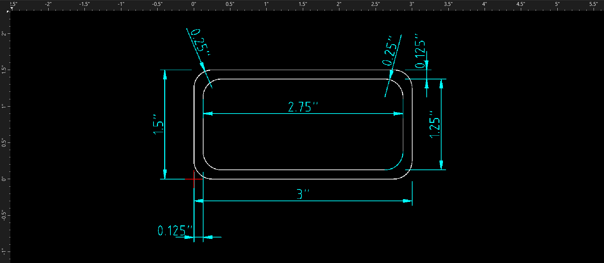
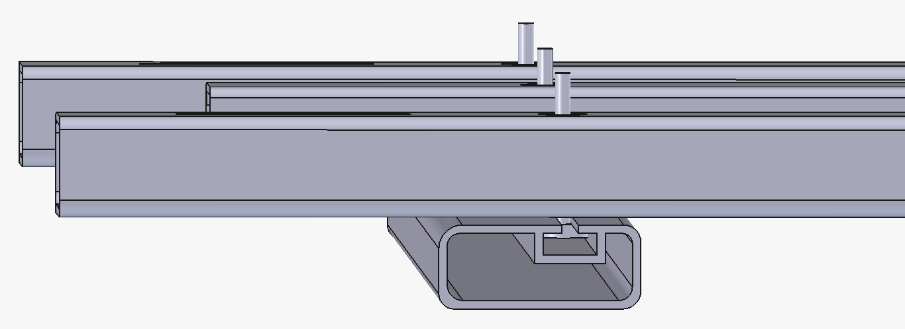
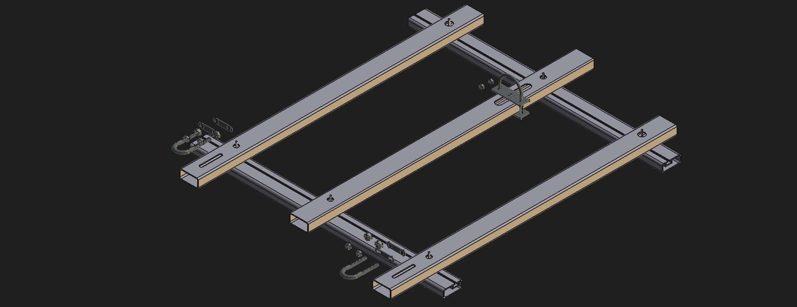

<h3 align="center">
  Documentation Under Construction . . .
</h3>

  documentation is under construction, continue to navigate docs & models to view renders, files, design notes and more.

  

 
 
 

<table>
  <tr>
    <td align="center">
      
    </td>
    <td align="center">
      
    </td>
    <td align="center">
      
    </td>
  </tr>
</table>

## Bike Rack Project Index

Bellow is a file tree where each leaf directs to the respective file or repository defined.  
  
├── [README.md](./README.md)  
  
├── [docs/](./docs/)                                                                                             # Documentation & engineering record  
│   │  
│   ├── [design notes/](./docs/design%20notes/)                                                                  # Dimensions & design decisions  
│   │   ├── [Center_Bar_Dimensions.dxf](./docs/design%20notes/Center_Bar_Dimensions.dxf)  
│   │   ├── [Driver-Passenger_Bar_Dimensions.dxf](./docs/design%20notes/Driver-Passenger_Bar_Dimensions.dxf)  
│   │   ├── [TBolt_Dimensions.dxf](./docs/design%20notes/TBolt_Dimensions.dxf)  
│   │   └── [roof rack.txt](./docs/design%20notes/roof%20rack.txt)  
│   │  
│   ├── [images/](./docs/images/)                                                                                # Visual documentation  
│   │   ├── [dimensions/](./docs/images/dimensions/)                                                             # CAD dimension screenshots  
│   │   ├── [renders/](./docs/images/renders/)                                                                   # CAD renders & FEA visuals  
│   │   └── [sketches/](./docs/images/sketches/)                                                                 # Initial concepts & hand sketches  
│   │  
│   ├── [journal/](./docs/journal/)                                                                              # Development history  
│   │   ├── [journal images/](./docs/journal/journal%20images/)  
│   │   ├── [2026-06-28-material-properties-test.md](./docs/journal/2026-06-28-material-properties-test.md)  
│   │   ├── [2026-11-17-update.md](./docs/journal/2026-11-17-update.md)  
│   │   └── [2026-11-21-scripting-workflow.md](./docs/journal/2026-11-21-scripting-workflow.md)  
│   │   └── . . .  
|   |  
│   ├── [research/](./docs/research/)                                                                            # Technical research  
│   │   └── [CAD-kernels.md](./docs/research/CAD-kernels.md)  
│   │  
│   └── [simulations/](./docs/simulations/)                                                                      # Engineering simulation  
│       ├── [FEM/](./docs/simulations/FEM/)                                                                      # Finite Element Method  
│       │   └── [structural-simulation.md](./docs/simulations/FEM/structural-simulation.md)  
│       │  
│       └── [FVM/](./docs/simulations/FVM/)                                                                      # Finite Volume Method  
│           └── [aerodynamic-simulation.md](./docs/simulations/FVM/aerodynamic-simulation.md)  
│  
└── [models/](./models/)                                                                                         # CAD & computational models  
    │  
    ├── [Roof-Rack_Bike-Rack-V3.FCStd](./models/Roof-Rack_Bike-Rack-V3.FCStd)                                    # Primary CAD assembly  
    │  
    ├── [bike rack u-bolts/](./models/bike%20rack%20%20u-bolts/)                                                 # Potential mounting components  
    │   ├── *.FCStd  
    │   ├── *.STEP  
    │   └── *.FCBak  
    │  
    ├── *.FCStd  — FreeCAD models  
    ├── *.STEP  — CAD interchange  
    ├── *.DXF  — Dimension drawings (QCAD) 
    └── *.PMX  — PrePoMax simulation models  
