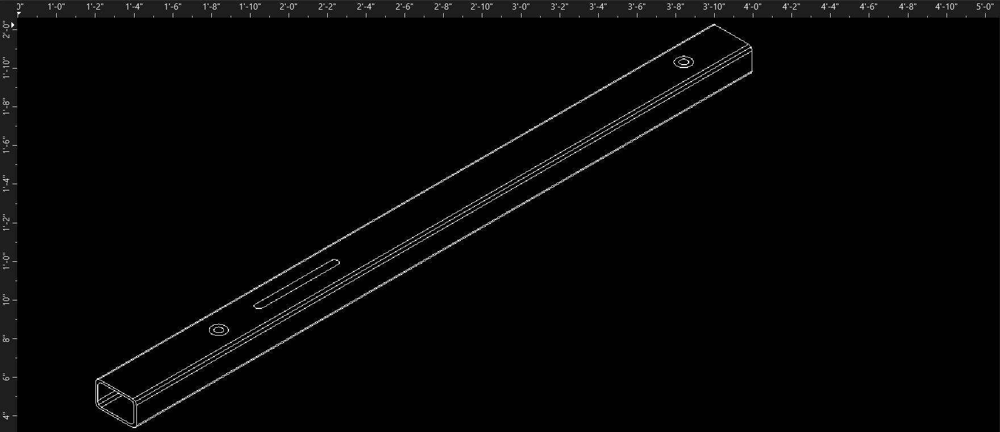
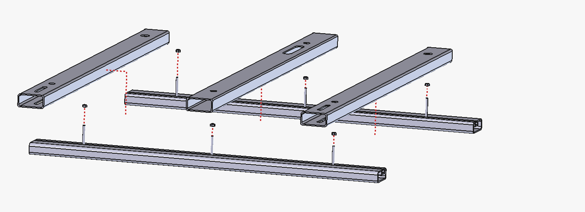
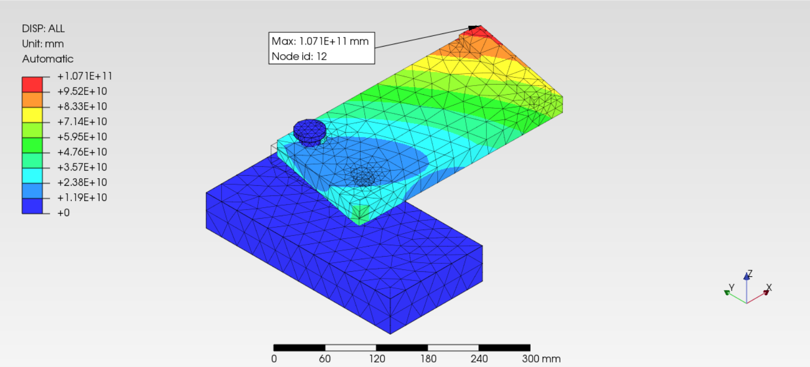

# Pictures

## Pictures that demonstrate the Drafting (QCAD), Modeling (FreeCAD), and FEA (PrePoMax)

<table>
  <tr>
    <td align="center">
      
       
      <em>Center Bar drafted in QCAD for dimensions</em>
    </td>
    <td align="center">
      
       
      <em>Exploded partial assembly in FreeCAD</em>
    </td>
    <td align="center">
      
       
      <em>Testing FEA techniques for bike rack</em>
    </td>
  </tr>
</table>

